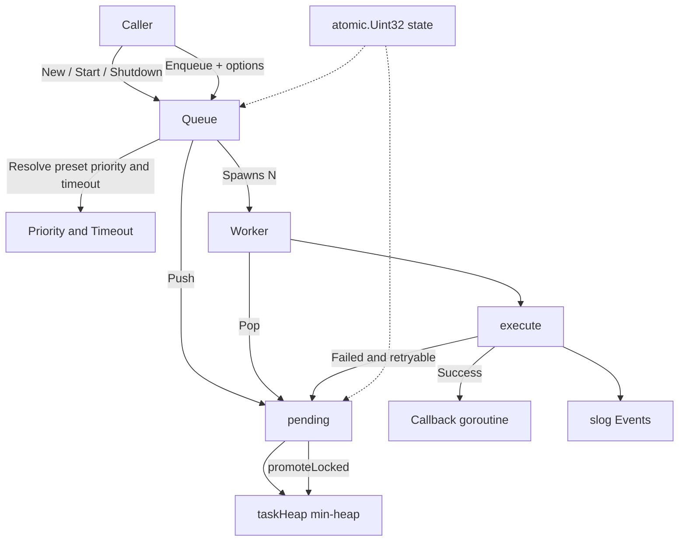

# Architecture

This page shows how go-queue's components relate in a single overview diagram; per-module diagrams, sequence diagrams, and state machines live in [doc/architecture.md](https://github.com/pardnchiu/go-queue/blob/master/doc/architecture.md).

## System Overview

## Layers

| Layer | Files | Responsibility |
|---|---|---|
| Public interface | `core/new.go`, `core/option.go` | `New` / `Start` / `Enqueue` / `Shutdown` and the four `EnqueueOption` helpers |
| Execution | `core/new.go` (`worker`, `execute`, `setRetry`) | Worker loop, timeout, panic recovery, retry decision, `slog` events |
| Scheduling | `core/pending.go` | Bounded queue: capacity check, closure check, `sync.Cond` wake-ups, auto-promotion |
| Data structure | `core/task.go` | `container/heap` min-heap and backing-slice shrinking |
| Rules | `core/priority.go`, `core/pending.go` (`getPromotion`) | Priority constants, timeout multipliers, and promotion thresholds |

## Cross-Cutting Principles

| Principle | Implementation |
|---|---|
| Lock-free lifecycle | Queue state is an `atomic.Uint32`; `Start` / `Shutdown` transition via CAS, and `pending` reads the same state to reject enqueues |
| One lock for heap work | `Push`, `Pop`, and promotion all run under `pending.mu`; idle workers sleep on `cond.Wait` instead of polling |
| Task fault isolation | Tasks run in their own goroutine with `recover`, and `select` enforces the timeout, so a worker never hangs or crashes |
| Bounded memory | Heap length is capped at `Config.Size`; once capacity exceeds 4 times the floor `max(16, min(Size/8, Size/Workers))`, the backing slice shrinks to a quarter (never below the floor) when length drops below 1/8 of capacity |
| Observability | Every outcome goes through `log/slog` with fixed event names (`task.completed`, `task.retrying`, and so on) |

## Further Reading

- Exact values and behavior of each rule → [Core Concepts](/core-concepts), which links to one page per rule
- Full module diagrams, sequence diagram, and state machines → [doc/architecture.md](https://github.com/pardnchiu/go-queue/blob/master/doc/architecture.md)
