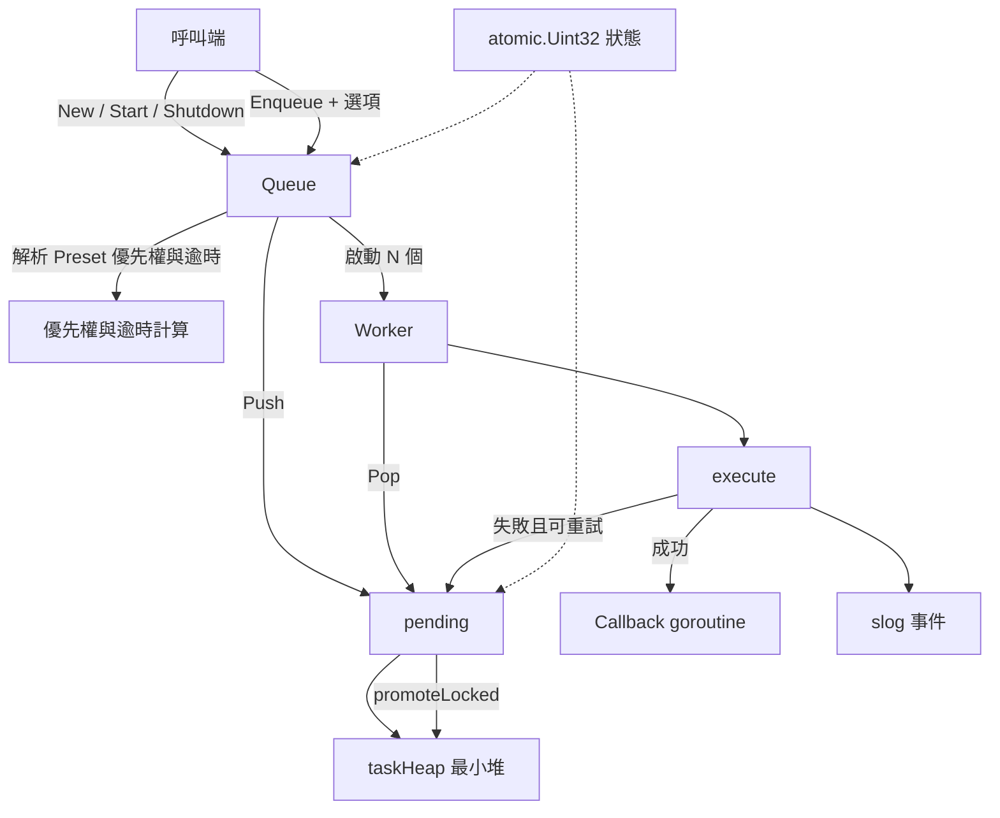

# 架構

本頁以一張概覽圖呈現 go-queue 各元件的層級關係；模組級的細部圖、時序圖與狀態機見 [doc/architecture.zh.md](https://github.com/pardnchiu/go-queue/blob/master/doc/architecture.zh.md)。

## 系統概覽

## 分層

| 層 | 檔案 | 職責 |
|---|---|---|
| 公開介面 | `core/new.go`、`core/option.go` | `New`／`Start`／`Enqueue`／`Shutdown` 與四個 `EnqueueOption` |
| 執行 | `core/new.go`（`worker`、`execute`、`setRetry`） | Worker 迴圈、逾時、panic 恢復、重試判斷、`slog` 事件 |
| 排程 | `core/pending.go` | 有界佇列：容量檢查、關閉判斷、`sync.Cond` 喚醒、自動升級 |
| 資料結構 | `core/task.go` | `container/heap` 最小堆與底層 slice 縮減 |
| 規則 | `core/priority.go`、`core/pending.go`（`getPromotion`） | 優先權常數、逾時倍率與升級門檻 |

## 跨切原則

| 原則 | 實作方式 |
|---|---|
| 生命週期無鎖 | Queue 狀態為 `atomic.Uint32`，`Start`／`Shutdown` 以 CAS 轉換；`pending` 讀同一個狀態判斷是否拒絕入列 |
| 堆操作單一鎖 | `Push`、`Pop`、升級都在 `pending.mu` 內完成，Worker 空閒時以 `cond.Wait` 休眠，不輪詢 |
| 任務故障隔離 | 任務在獨立 goroutine 中執行並 `recover`，逾時由 `select` 判斷，Worker 不會被卡住或崩潰 |
| 有界記憶體 | 堆長度上限為 `Config.Size`；容量超過下限 `max(16, min(Size/8, Size/Workers))` 的 4 倍後，長度低於容量 1/8 時底層 slice 縮為四分之一（不低於下限） |
| 可觀測性 | 所有結果都經由 `log/slog` 輸出，事件名稱固定（`task.completed`、`task.retrying` 等） |

## 延伸閱讀

- 各規則的數值與行為 → [核心概念](/zh/core-concepts)，由此連到每條規則的獨立頁
- 完整模組圖、時序圖與狀態機 → [doc/architecture.zh.md](https://github.com/pardnchiu/go-queue/blob/master/doc/architecture.zh.md)
