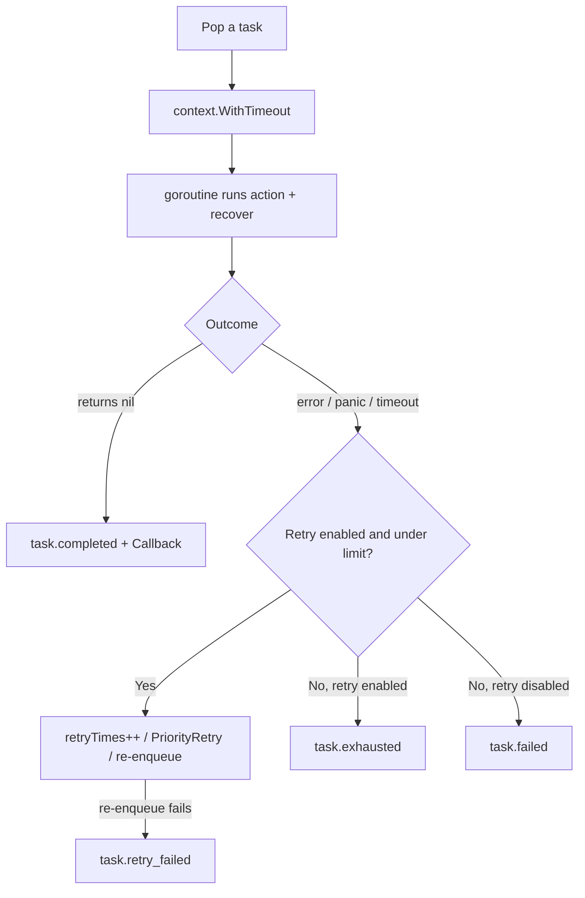

# Execution and Retries

This page explains how a worker runs one task, how panics, timeouts, and errors are reported, and how retries re-enter the queue.

## Executing a Task

`execute` runs the task function in its own goroutine and waits on both the result and the ctx (`core/new.go:118`).

| Case | Result |
|---|---|
| panic | `recover` turns it into a `panic: <value>` error; the worker is unaffected |
| timeout | Reports `task timeout after <d>`; if the task ignores `ctx.Done()`, its goroutine keeps running until it returns |
| `Start` ctx cancelled | The task ctx is cancelled too; the error is `ctx.Err()` |
| success with callback | The callback runs with the task ID in a new goroutine; it never runs on failure |

## Retries

`WithRetry()` allows up to 3 retries and `WithRetry(n)` allows `n`; total runs are `n + 1`.

| Behavior | Detail |
|---|---|
| Re-entry | Immediately at `PriorityRetry`, with no backoff delay |
| Timeout | Keeps the original timeout |
| Wait time | `startAt` resets, so promotion timing starts over |
| Re-enqueue blocked | When the heap is full or the queue is closed, the task is dropped and `task.retry_failed` is logged |

Each outcome emits a fixed `slog` event, listed in [Log Events](/api-reference-events).
