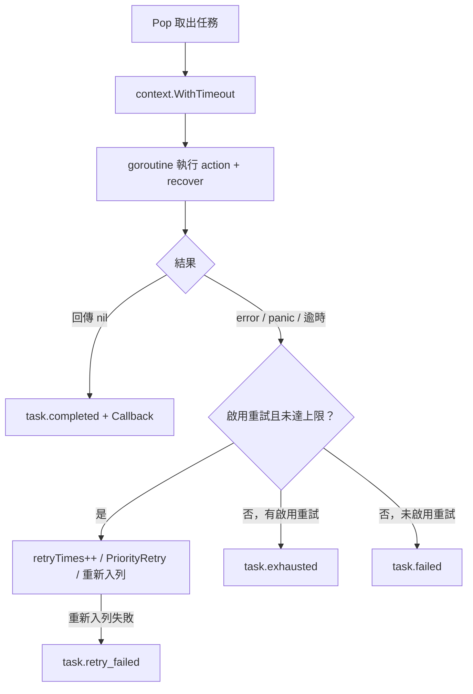

# 執行與重試

本頁說明 Worker 如何執行單一任務、panic／逾時／錯誤如何回報，以及重試如何重新進入佇列。

## 單一任務的執行

`execute` 在獨立 goroutine 中執行任務函式，同時等待結果與 ctx（`core/new.go:118`）。

| 情境 | 結果 |
|---|---|
| panic | `recover` 轉成 `panic: <value>` 錯誤，Worker 不受影響 |
| 逾時 | 回報 `task timeout after <d>`；任務若不理會 `ctx.Done()`，其 goroutine 會持續執行到自行返回 |
| `Start` 的 ctx 被取消 | 任務 ctx 一併取消；錯誤為 `ctx.Err()` |
| 成功且有 Callback | 以新 goroutine 帶任務 ID 呼叫 Callback；失敗時不會呼叫 |

## 重試

`WithRetry()` 最多重試 3 次，`WithRetry(n)` 最多 `n` 次；總執行次數為 `n + 1`。

| 行為 | 說明 |
|---|---|
| 重新入列 | 立即以 `PriorityRetry` 入列，沒有退避延遲 |
| 逾時 | 沿用原本的逾時 |
| 等待時間 | `startAt` 重設，升級計時重新開始 |
| 無法重新入列 | 堆已滿或佇列已關閉時，任務被丟棄並記錄 `task.retry_failed` |

每種結果都會發出固定名稱的 `slog` 事件，見 [日誌事件](/zh/api-reference-events)。
